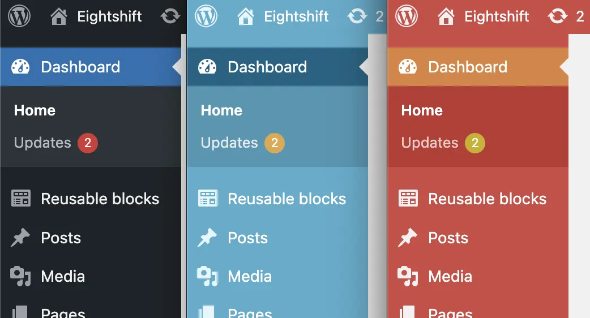
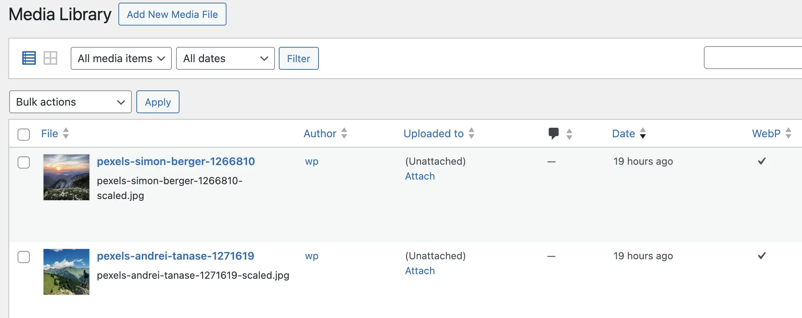

---
{
  "title": "Tips & useful features",
  "description": "Various tips and useful features for your project included in Eightshift DevKit.",
  "permalink": "/blog/tips-useful-features",
  "date": "2024-02-29T00:00:00.000Z",
  "readingTime": 5.49,
  "authors": [
    {
      "name": "Igor Obradović",
      "title": "WordPress Engineer",
      "url": "https://github.com/iobrado",
      "imageURL": "https://avatars.githubusercontent.com/u/23059501?v=4",
      "key": "obradovic",
      "page": null
    }
  ],
  "tags": [
    {
      "inline": true,
      "label": "eightshift",
      "permalink": "/blog/tags/eightshift"
    },
    {
      "inline": true,
      "label": "boilerplate",
      "permalink": "/blog/tags/boilerplate"
    },
    {
      "inline": true,
      "label": "blocks",
      "permalink": "/blog/tags/blocks"
    },
    {
      "inline": true,
      "label": "plugins",
      "permalink": "/blog/tags/plugins"
    },
    {
      "inline": true,
      "label": "colors",
      "permalink": "/blog/tags/colors"
    },
    {
      "inline": true,
      "label": "images",
      "permalink": "/blog/tags/images"
    },
    {
      "inline": true,
      "label": "classes",
      "permalink": "/blog/tags/classes"
    }
  ],
  "summary": "Eightshift DevKit has lots of features that can make your development experience easier. These are mostly minor features which can’t be a blog post of its own, so they’ll be listed here. This isn’t a complete list, so there may be a part 2 in the future."
}
---

Eightshift DevKit has lots of features that can make your development experience easier. These are mostly minor features which can’t be a blog post of its own, so they’ll be listed here. This isn’t a complete list, so there may be a part 2 in the future.


## Using only Eightshift blocks

If you want to remove the default Gutenberg blocks and use only Eightshift blocks, it’s as easy as adding the following code in your **_src/Blocks/Blocks.php_** file:

```php
// Limits the usage of only custom project blocks.
\add_filter('allowed_block_types_all', [$this, 'getAllBlocksList'], 10, 2);
```

## ModifyAdminAppearance class

When you have multiple environments (local, staging, production ...), you may accidentally change something on the wrong environment if you mix up your tabs. The `ModifyAdminAppearance` class changes your WP Admin color scheme depending on the environment type defined with the `WP_ENVIRONMENT_TYPE` constant. That way it’s much easier to differentiate on which environment you are when you're in WP Admin.

Now when you get a call from the client asking you why the blog post they published isn’t visible on the site, the first question you can ask is: “What color is the admin area?” 😄

To add it into your project, use the following WP-CLI command:

```bash
wp boilerplate create modify-admin-appearance
```

After adding this class to your project, all you have to do is define the proper environment type in the `WP_ENVIRONMENT_TYPE` constant in ***wp-config.php.***

The supported values are:

- local
- development
- staging
- production



If you want to change any of the colors, you can do so by modifying the values in `COLOR_SCHEMES` array inside `ModifyAdminAppearance` class. For the full list of available color schemes, you can navigate to **_wp-admin/css/colors_**. The subfolders here represent the color schemes you can use. For example, if you want to change production environment color scheme to `coffee`, you would do it like this:

```php
/**
 * List of admin color schemes.
 *
 * @var array<string, string>
 */
public const COLOR_SCHEMES = [
	'development' => 'fresh',
	'local' => 'fresh',
	'staging' => 'blue',
	'production' => 'coffee',
];
```

## EscapedView class

This class can be used to define which tags and attributes are escaped or allowed in your project. To add the class into your project, use the following WP-CLI command:

```bash
wp boilerplate create escaped-view
```

Here’s an example how to define the allowed tags so `wp_kses` doesn’t remove them:

```php
	/**
	 * Add tags to allowed HTML list.
	 *
	 * @param array<string, array<mixed>> $tags Allowed tags.
	 *
	 * @return array<string, array<mixed>>
	 */
	public function ksesAllowedHtml($tags): array
	{
		$tags['source'] = [
			'src' => [],
			'type' => [],
		];

		$tags['video'] = [
			'muted' => [],
			'src' => [],
			'autoplay' => [],
			// ...
		];

		$tags['div']['data-*'] = true;

		return \array_merge(
			$tags,
			static::SVG,
			static::FORM,
			static::IFRAME
		);
	}
```

:::caution
Please be wary of the attributes you allow, as this could expose your website to cross-site scripting (XSS) and similar attacks!
:::

Don’t forget to add this to the `register` method:

```php
\add_filter('wp_kses_allowed_html', [$this, 'ksesAllowedHtml'], 20, 1);
```

## Media class

To add the Media class to your project, use the following WP-CLI command:

```bash
wp boilerplate create media
```

You can use the Media class to define new media sizes or allow uploads of the mime types that are not allowed by default.

```php
	/**
	 * Allow additional types for uploads in media.
	 *
	 * @param array<string, string> $mimes Load all mimes types.
	 *
	 * @return array<string, string> Return original and updated.
	 */
	public function enableMimeTypes(array $mimes): array
	{
		$mimes['svg']  = 'image/svg+xml';
		$mimes['zip']  = 'application/zip';
		$mimes['json'] = 'application/json';

		return $mimes;
	}
```

And register the filter:

```php
\add_filter('upload_mimes', [$this, 'enableMimeTypes']);
```

This class also supports converting your media into **_WebP_** format, but more on that below.

## Automatic WebP conversion

The WebP file format is becoming more and more popular, with its smaller file sizes and better compression, it is a preferred replacement for .jpg and .png formats. Eightshift DevKit supports converting your existing files to WebP format.

If you already have the Media class in your project, you need to run this WP-CLI command:

```bash
wp boilerplate create webp-media-column
```

This command will add a new column in your ***List view*** in Media Library that shows if the media is converted to WebP or not.



To enable and convert existing media to WebP, run the following commands:

```bash
wp boilerplate run use-webp-media
wp boilerplate run regenerate-media
```

After running these commands, you’ll have your images converted to WebP. Some formats like `svg` will not be converted, this is intended.

Please note that the original files will not be deleted and you’ll have to add additional logic to your Image component for replacing the URLs.

Here’s a simple example how to do it:

```php
// Check if webP is used from admin.
$isWebPUsed = Components::isWebPMediaUsed();

// If webP is used override the url for large.
if ($isWebPUsed) {
	$sourceWebPLarge = Components::getWebPMedia($imageUrl['large'], Media::WEBP_ALLOWED_EXT);

	if ($sourceWebPLarge) {
		$imageUrl['large'] = $sourceWebPLarge['src'];
	}
}
```

## Dynamic cookies for WP Rocket

This is quite useful when you have a GDPR plugin and you have to take the cookie value into consideration when serving the cached version of the site.

To add the GDPR cookie to the list of dynamic cookies, create a new class called Rocket with the following WP-CLI command:

```bash
wp boilerplate create service-example --folder=Plugins/Rocket --file_name=Rocket
```

Add the following method to the Rocket class:

```php
	/**
	 * List all dynamic cookies that will create new cached version.
	 *
	 * @param array<string> $items Items from the admin.
	 *
	 * @return array<string>
	 */
	public function dynamicCookiesList(array $items): array
	{
		$items[] = 'gdpr';

		return $items;
	}
```

Finally, add the following filter to the `register` method:

```php
\add_filter('rocket_cache_dynamic_cookies', [$this, 'dynamicCookiesList']);
```

## Yoast SEO helper

The content generated by Eightshift blocks may be difficult for Yoast SEO to interpret, but there is a Yoast SEO helper included in our DevKit that fixes the issue and makes the content readable to Yoast SEO. By default, Yoast SEO can't read the content from custom dynamic blocks, so this helper tells it how to parse the content from the blocks.

To enable this, you have to add the following in **_src/Blocks/assets/scripts/application-blocks-editor.js_**:

```jsx
import { yoastSeo } from '@eightshift/frontend-libs/scripts/plugins';

// ...

yoastSeo();
```

## Linters and Coding Standards checks

Eightshift DevKit includes coding standards checks that will help you improve your code quality.

To run these commands, you have to be in the theme root folder. Here’s the list:

- `npm run lintStyle` - check your CSS files with StyleLint
- `npm run lintJs` - check your JS files with ESLint
- `composer test:standards` - check PHP coding standards errors with PHPCS
- `composer test:types` - runs PHPStan static code analysis
